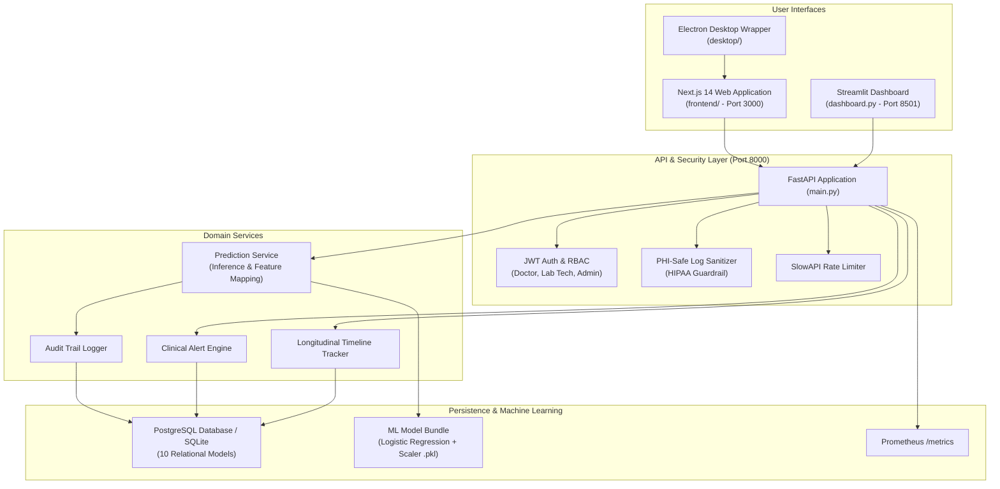

# CKD-CI Project Audit & Detailed Technical Report

**Document Date:** November 2026  
**Repository Inspected:** `D:\Projects\CKD-CI`  
**Classification:** Healthcare AI / Clinical Decision Support System (CDSS)

---

## 1. What Is This Project?

**CKD-CI** (*Chronic Kidney Disease – Cognitive Impairment*) is an enterprise-oriented Clinical Decision Support System (CDSS). Its primary medical objective is to predict the risk of cognitive impairment in patients suffering from Chronic Kidney Disease (CKD) using standard demographic, clinical, and laboratory markers.

### Clinical Background & Problem Solved
Patients with moderate-to-advanced CKD frequently develop vascular and uremic cognitive disorders. Early detection enables nephrologists and primary care physicians to adjust dialysis regimens, optimize blood pressure, control anemia, and initiate early neurocognitive interventions. Rather than requiring expensive specialized neuro-imaging, CKD-CI uses routine blood, urine, and vitals tests to stratify patients into four cognitive risk tiers:
- **Class 0:** No Cognitive Risk
- **Class 1:** Low Cognitive Risk
- **Class 2:** Moderate Cognitive Risk
- **Class 3:** High Cognitive Risk

### High-Level Architecture



---

## 2. What Is Implemented?

The repository contains a substantial, multi-tier codebase covering machine learning, backend microservices, database persistence, and multi-platform frontends.

### 2.1 Backend Services & API (`main.py` + `api/routes/`)
A modular FastAPI backend featuring 14 distinct functional routers:
1. **`api/routes/auth.py`**: JWT-based access token creation, login, user registration, and bcrypt password hashing.
2. **`api/routes/predictions.py`**: Single-patient risk inference (`/predictions/predict`) and bulk CSV inference (`/predictions/batch`).
3. **`api/routes/patients.py`**: Patient record management, demographics, and historical cognitive evaluation profiles.
4. **`api/routes/timeline.py`**: Longitudinal clinical events tracking (recording past tests, status changes, and clinical milestones).
5. **`api/routes/alerts.py`**: Automated risk alert generation when specific biomarkers or predicted risk thresholds are exceeded.
6. **`api/routes/notes_tasks.py`**: Collaborative clinical notes and action-item task tracking for healthcare providers.
7. **`api/routes/chat.py`**: Contextual clinical assistant chat service with persistent session threads.
8. **`api/routes/explain.py`**: Feature attribution and model interpretability explanations.
9. **`api/routes/monitoring.py`**: Model drift indicators, prediction latency snapshots, and inference counters.
10. **`api/routes/admin.py`**: Administrative analytics, system status, and user management.
11. **`api/routes/models.py`**: Model governance registry for tracking active and candidate model versions.
12. **`api/routes/clinical_ops.py`**: Operational triage queue and clinician workflow management.
13. **`api/routes/audit.py`**: HIPAA-compliant audit trail search and export.
14. **`api/routes/users.py`**: User profile queries and permissions management.

### 2.2 Security & Compliance (`core/`)
- **PHI-Safe Logging (`core/log_sanitizer.py`)**: Sanitizes log records before writing to disk, ensuring patient names, MRNs, and direct medical indicators are masked to satisfy HIPAA guidelines.
- **Role-Based Access Control (`core/deps.py`)**: Fine-grained route dependencies enforcing `Admin`, `Doctor`, or `Lab Technician` privileges.
- **Middleware Protections (`core/middleware.py`)**: UUID request-id tracing, per-request execution timeouts (10s default), request payload size caps (5MB default), and SlowAPI rate limiting (100 req/min).
- **Observability (`core/metrics.py`)**: Exposes native metrics at `/metrics` and Prometheus-compatible metrics at `/metrics/prometheus`.

### 2.3 Persistence & Database Models (`db/`, `models/`, `alembic/`)
- **SQLAlchemy ORM (`models/`)**: 10 defined relational entities: `User`, `Patient`, `Prediction`, `Alert`, `AuditLog`, `ChatSession`, `ChatMessage`, `ClinicalNote`, `ClinicalTask`, and `TimelineEvent`.
- **Alembic Migrations (`alembic/`)**: Versioned schema generation scripts (`alembic/versions/initial_migration.py`).
- **Auto-Seeding (`services/demo_data.py`)**: Automatic generation of initial admin credentials (`admin@example.com` / `change_me`) and sample patient cohorts on development startup.

### 2.4 Machine Learning & Analytics (`results/`, `services/`)
- **Trained Model Artifacts (`results/model_bundle.pkl`)**: Serialized joblib bundle containing a trained `LogisticRegression` classifier, `StandardScaler`, 18 feature names, calibrated probability thresholds, and 4-tier risk labels.
- **Feature Pipeline (`services/prediction_service.py`)**: Standardizes 18 biomarkers (`age`, `education_years`, `gender`, `eGFR`, `creatinine`, `bun`, `uacr`, `hemoglobin`, `albumin`, `hsCRP`, `potassium`, `phosphate`, `calcium`, `systolic_bp`, `bmi`, `diabetes`, `hypertension`, `cvd`).
- **Clinical Decision Support (`services/clinical_decision_support.py`)**: Contextual clinical recommendations tailored to the output risk tier.
- **Trajectory Forecasting (`services/risk_progression.py`)**: Analyzes temporal deltas in biomarker readings to report risk velocity.

### 2.5 User Interfaces
1. **Next.js 14 Web App (`frontend/`)**: Modern React 18, TypeScript, and Tailwind CSS SPA featuring:
   - Dedicated pages: `/prediction`, `/patients`, `/patients/[id]`, `/command-center`, `/alerts`, `/monitoring`, `/timeline`, `/chat`, and `/admin`.
   - Reusable UI kit (`components/ui/`), auth route guards, and toast notifications.
2. **Streamlit Clinician Dashboard (`dashboard.py`)**: Comprehensive 1,450-line interactive dashboard with Plotly charts, batch file uploaders, drift panels, and PDF export stubs.
3. **Electron Desktop Application (`desktop/`)**: Wrapper allowing the Next.js app to be packaged as a native Windows desktop executable (`.exe`).

### 2.6 Deployment & Orchestration
- **Docker Compose**: Multi-container setup for API, Dashboard, PostgreSQL, Prometheus, and Grafana.
- **Kubernetes Manifests (`k8s/`)**: Declarative deployments and service configs for the API, Streamlit dashboard, and Postgres database.
- **CI/CD (`.github/workflows/`)**: GitHub Actions workflows for Python testing, Frontend validation, and ML model training triggers.

---

## 3. What Is Broken? (Defects & Technical Debt)

During the codebase inspection, several critical blockers, runtime errors, and structural defects were identified:

### 🔴 Critical Defect 1: Dead ML Scripts Calling Non-Existent Packages (`src.*` and `data.*`)
Three high-profile ML scripts fail immediately with `ModuleNotFoundError`:
- `advanced_ml_models_example.py`
- `train_deep_learning_models.py`
- `import_real_datasets.py`

**Root Cause:**
All three scripts attempt to import modules such as:
```python
from data.generate_synthetic_data import CKDCognitiveDataGenerator
from src.preprocessing import preprocess_pipeline
from src.models import DeepNeuralNetworkModel, ConvolutionalNeuralNetworkModel, RecurrentNeuralNetworkModel
from src.data_importers import NHANESImporter, CharlesDatasetImporter
```
The folders `src/` and `data/` **do not exist** anywhere in the repository. These files are broken legacy artifacts from an earlier project layout.

---

### 🔴 Critical Defect 2: Schema & Feature Name Mismatch (Validation vs. Model)
There is a direct contradiction between the server-side input validator and the trained model:
- In `core/validation.py`: `CLINICAL_RANGES` checks for keys `egfr` (lowercase) and `phosphorus` (spelled out), while **omitting** `education_years` and `hsCRP`.
- In `results/model_bundle.pkl` & `infer_single_patient.py`: The model requires `eGFR` (camel-case), `phosphate`, `education_years`, and `hsCRP`.
- In `frontend/app/prediction/page.tsx`: The UI explicitly runs `normalizeFeatures()` which renames `eGFR` to `egfr` and `phosphate` to `phosphorus` and deletes the canonical keys to pass `core/validation.py`.
- In `services/prediction_service.py`: A brittle translation layer was hacked in with hardcoded fallbacks (`education_years: 12`, `hscrp: 2.0`, `phosphate: 3.5`) because valid model inputs were missing from requests.

**Impact:** Clinical predictions via the API either fail validation or use synthetic constant fallbacks for critical lab values (`hsCRP`, `education_years`).

---

### 🔴 Critical Defect 3: Broken / Invalid Docker Compose & Dockerfile
- **`docker-compose.yml` is corrupt/invalid YAML:** Two separate `docker-compose.yml` files were pasted into a single file. Line 1 starts service definitions, and line 59 repeats `version: '3.8'` with duplicate top-level keys (`services:`, `volumes:`). Running `docker compose up` results in a YAML parse error.
- **Conflicting database environments:**
  - `docker-compose.yml` (top half): database `ckdci`, user `ckdci`
  - `docker-compose.yml` (bottom half): database `ckdci`, user `postgres`
  - `docker-compose.frontend.yml`: database `ckdci_db`, user `postgres`
  - `.env.example`: `DATABASE_URL=postgresql+psycopg2://postgres:postgres@db:5432/ckdci`
- **Corrupt `Dockerfile`:** Contains two separate `FROM` lines (`FROM python:3.11-slim` running `main:app`, followed by `FROM python:3.12-slim` running `api_server:app`). The second image completely overrides the first. Furthermore, the second image copies `requirements-runtime.txt`, which is unreadable in Linux.

---

### 🔴 Critical Defect 4: UTF-16LE Encoding on `requirements-runtime.txt`
`requirements-runtime.txt` is encoded in **UTF-16LE with BOM** (a side effect of PowerShell redirection `>`). 
Linux containers and standard pip commands cannot parse this file and abort with:
`UnicodeDecodeError: 'utf-8' codec can't decode byte...`

---

### 🟡 High Defect 5: Missing Virtual Environment & Conflicting Requirements
- **Missing Environment:** Nearly every launcher script (`launch.bat`, `run_all.bat`, `run_menu.ps1`, `scripts/health_check.ps1`, `scripts/run_local.ps1`, `scripts/start_desktop_dev.ps1`) hardcodes the path:
  `.\.venv312\Scripts\python.exe`
  However, `.venv312` does not exist in the repository.
- **Conflicting `requirements.txt`:** The file has duplicate, contradictory package pins:
  - `joblib` at line 10 vs. `joblib==1.3.1` at line 38
  - `scikit-learn` at line 11 vs. `scikit-learn==1.3.0` at line 24 vs. `>=1.4.2` at line 25
  - `streamlit` at line 12 vs. `streamlit==1.26.0` at line 45 vs. `>=1.50.0` at line 46
  - `scipy==1.11.1` at line 36 vs. `scipy>=1.11.4` at line 44

---

### 🟡 High Defect 6: Dual Entry Points & Code Duplication
- **FastAPI:** `main.py` (complete production app with 14 routers and middleware) vs. `api_server.py` (older, monolithic prototype with duplicate inline logic).
- **Streamlit:** `dashboard.py` (1,458 lines in root) vs. `dashboard/streamlit_app.py` (111 lines in subdirectory).
- **API Client:** `services/api_client.py` (current) vs. `api_client.py` (outdated clone in root).

---

### 🟡 Medium Defect 7: Test Suite Failures & Fragile Coupling
- Running `pytest` fails immediately across 6 test modules (`test_api_smoke.py`, `test_authz.py`, `test_health.py`, `test_metrics_endpoint.py`, `test_prediction_logging.py`, `test_request_middleware.py`) due to missing packages in the local environment.
- `tests/test_schema.py` imports directly from the root utility script `infer_single_patient.py` (`from infer_single_patient import FEATURE_COLUMNS...`) rather than from the project's internal packages (`core` or `schemas`).

---

### 🟡 Medium Defect 8: Hardcoded Developer Machine Paths
Several handoff markdown files contain hardcoded local machine paths:
- `C:\Users\hp\OneDrive\Documents\Downloads\CKD-CI (2)\CKD-CI` appears in `FINAL_WORKING_PROJECT.md`, `DASHBOARD_QUICK_START.md`, and `STABILIZATION_COMPLETE.md`.

---

## 4. Comprehensive Inventory of Unwanted & Redundant Files

The project has accumulated build artifacts, experimental outputs, and over 30 AI-generated completion summaries directly in the workspace root. Below is the complete catalog of files recommended for removal or relocation.

| Category | File / Path | Reason for Removal / Action Needed |
| :--- | :--- | :--- |
| **Committed Build Artifacts** | `frontend/.next/` (147 files, `.pack.gz`, `.hot-update.js`, etc.) | **Delete and untrack.** Build output should never be checked into Git; bloats git history and causes stale build errors. |
| **Runtime Plot & CSV Clutter (Root)** | `advanced_logistic_results.csv` | Output file generated by ad-hoc analysis; move to `results/` or delete. |
| | `advanced_roc_curve.png` | Plot generated in root; move to `results/` or delete. |
| | `cv_scores.png` / `feature_importance.png` / `kdi_distribution.png` / `roc_curve.png` | Ad-hoc generated plots sitting in root; move to `results/`. |
| | `pipeline_output.txt` | Leftover console stdout dump; delete. |
| | `sample_patient.csv` | Sample test fixture sitting in root; relocate to `tests/fixtures/`. |
| | `vif_results.csv` | Statistical multicollinearity output sitting in root; relocate to `results/`. |
| **Dead / Broken Python Scripts** | `advanced_ml_models_example.py` | Broken imports (`from src.*`, `from data.*`); dead code. |
| | `train_deep_learning_models.py` | Broken imports (`from src.*`, `from data.*`); dead code. |
| | `import_real_datasets.py` | Broken imports (`from src.*`); dead code. |
| **Redundant Code Duplications** | `api_server.py` | Superseded by `main.py`. Redundant duplicate API entry point. |
| | `api_client.py` (Root) | Superseded by `services/api_client.py`. |
| | `dashboard/streamlit_app.py` | Superseded by root `dashboard.py` (or move `dashboard.py` into `dashboard/app.py`). |
| | `Dockerfile` | Broken concatenated duplicate of `Dockerfile.api`. |
| | `requirements-runtime.txt` | UTF-16LE corrupted duplicate of `requirements.txt`. |
| **Ad-Hoc Standalone Scripts (Root)** | `advanced_statistical_analysis.py` | Research script; should be moved to `scripts/` or `notebooks/`. |
| | `generate_graphs.py` | Research script; should be moved to `scripts/` or `notebooks/`. |
| | `quick_test.py` | Quick test script; should be moved to `scripts/` or `tests/`. |
| | `run_advanced_models.py` | Standalone trainer; should be moved to `scripts/` or `ml/`. |
| | `run_complete_pipeline.py` | Standalone pipeline; should be moved to `scripts/` or `ml/`. |
| | `infer_single_patient.py` | CLI inference script; should be moved to `scripts/` or `cli/`. |
| **Redundant Launcher Scripts (Root)** | `launch.bat`, `launch_web_app.bat`, `launch_web_app.ps1`, `run_all.bat`, `run_menu.ps1` | 5 overlapping root launcher scripts duplicating scripts in `scripts/`. Consolidate into 1 unified root script. |
| **Proliferation of AI Markdown Summaries (Root)** | Over 25 markdown/txt handoff files: <br>• `ADVANCED_ML_IMPLEMENTATION.md`<br>• `ADVANCED_MODELS_DEPLOYMENT_SUMMARY.txt`<br>• `ADVANCED_MODELS_GUIDE.md`<br>• `DASHBOARD_QUICK_START.md`<br>• `DASHBOARD_VISUAL_GUIDE.md`<br>• `DATASET_IMPORT_GUIDE.md`<br>• `DATASET_IMPORT_SUCCESS.md`<br>• `DELIVERABLES.md`<br>• `DEPLOYMENT_READY.md`<br>• `ENHANCEMENT_SUMMARY.md`<br>• `EXECUTION_SUCCESS_SUMMARY.txt`<br>• `FINAL_SUMMARY.md`<br>• `FINAL_WORKING_PROJECT.md`<br>• `IMPLEMENTATION_SUMMARY.md`<br>• `MODELS_DOCUMENTATION_INDEX.md`<br>• `NEW_MODELS_OVERVIEW.md`<br>• `PR_DESCRIPTION.md`<br>• `PRODUCTION_HEALTHCARE_AI_PLATFORM.md`<br>• `PROJECT_STRUCTURE.md`<br>• `QUICK_MODELS_REFERENCE.md`<br>• `QUICK_REFERENCE.md`<br>• `QUICKSTART.md`<br>• `QUICKSTART_PRODUCTION.md`<br>• `RUN_INSTRUCTIONS.txt`<br>• `STABILIZATION_COMPLETE.md`<br>• `SYSTEM_COMPLETE_GUIDE.md`<br>• `SYSTEM_READY.md`<br>• `UI_UX_IMPROVEMENTS.md`<br>• `VERIFICATION_CHECKLIST.md`<br>• `WEB_APP_SETUP_GUIDE.md`<br>• `WEB_APP_VISUAL_GUIDE.md` | **Consolidate & clean.** Every iteration of development generated a new large markdown file in root. <br><br>Consolidate relevant operational and architectural instructions into a clean `docs/` folder, and keep only `README.md` in root. |

---

## 5. Recommended Enhancements Roadmap

### Phase 1: Repository Cleanup & Foundation (Immediate)
1. **Remove Build Artifacts & Fix `.gitignore`**:
   - Untrack and remove `frontend/.next/` from Git.
   - Add `.next/`, `*.egg-info/`, `desktop/dist/`, `desktop/build/`, `*.png`, and `*.csv` (generated) to `.gitignore`.
2. **Consolidate Documentation & Delete Dead Scripts**:
   - Move essential architecture documentation into `docs/` and remove redundant summary files from root.
   - Delete dead scripts importing non-existent `src.*` (`advanced_ml_models_example.py`, `train_deep_learning_models.py`, `import_real_datasets.py`).
   - Eliminate duplicated files (`api_server.py`, `api_client.py`, corrupt `Dockerfile`, `requirements-runtime.txt`).
3. **Consolidate Entry Points**:
   - Standardize on `main.py` for FastAPI.
   - Standardize on a single Streamlit location (e.g., `dashboard/app.py`).

### Phase 2: Schema Harmonization & Configuration (Short-Term)
1. **Standardize Feature Taxonomy**:
   - Unify feature names across `core/validation.py`, `schemas/prediction.py`, `services/prediction_service.py`, and `frontend/`.
   - Use exact standard medical labels: `eGFR`, `phosphate`, `hsCRP`, `education_years`, `bun`, `uacr`, etc.
   - Remove the brittle ad-hoc defaults dictionary in `PredictionService`.
2. **Harmonize Docker & Compose**:
   - Fix `docker-compose.yml` by removing the concatenated duplicate block.
   - Unify database credentials across `.env.example`, `docker-compose.yml`, and `docker-compose.frontend.yml`.
   - Update `Dockerfile.api` to install cleanly from a deduplicated, UTF-8 `requirements.txt`.
3. **Dependency Modernization**:
   - Migrate to a modern packaging standard like `pyproject.toml` with `hatchling` or `flit`, or manage locks with `uv`.

### Phase 3: Clinical ML & Predictive Governance (Mid-Term)
1. **Transition from Synthetic Data to Real Clinical Cohorts**:
   - The current models are trained on synthetically generated distributions. Re-train and benchmark against real open clinical datasets (e.g., NHANES or MIMIC-IV).
2. **Conformal Prediction & Uncertainty Quantification**:
   - Clinical models should output guaranteed prediction intervals and alert clinicians when patient biomarker combinations fall outside the model's training distribution (out-of-distribution detection).
3. **Automated Drift & Performance Monitoring**:
   - Connect the Prometheus metrics collector to an automated alerting pipeline (e.g., Alertmanager or Grafana alerts) for feature drift and prediction shifts.

### Phase 4: Enterprise Healthcare Integration (Long-Term)
1. **HL7 / FHIR Ingestion Interface**:
   - Implement an HL7 FHIR (Fast Healthcare Interoperability Resources) endpoint to ingest patient lab results directly from hospital EHR systems (Epic, Cerner), eliminating manual 18-field clinical data entry.
2. **Audit & Compliance Hardening**:
   - Add database encryption-at-rest configurations and an automated retention policy for HIPAA-compliant audit logs.
